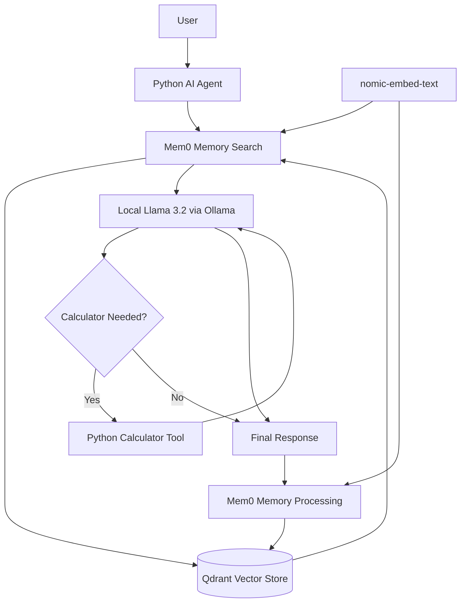

# Local AI Agent with Persistent Memory

A Python-based AI assistant that runs locally using Ollama
and Llama 3.2, with persistent memory powered by Mem0 and
Qdrant. It can retrieve relevant information from previous
conversations and use a Python calculator tool for arithmetic.

## Features

- Local language model inference using Ollama.
- Persistent conversational memory using Mem0.
- Semantic memory retrieval using Qdrant.
- Calculator tool for arithmetic expressions.
- Interactive command-line interface.
- Local-first setup without a paid LLM API.

## Technology Stack

- Python
- Ollama
- Llama 3.2 (3B)
- Mem0
- Qdrant
- nomic-embed-text


## Architecture



### Architecture Overview

- **Python AI Agent:** Coordinates the user's question, memory retrieval, model response, and tool execution.
- **Ollama and Llama 3.2:** Generate responses locally.
- **Mem0:** Extracts and retrieves useful information from conversations.
- **Qdrant:** Stores vector-based memories locally.
- **nomic-embed-text:** Converts text into embeddings for semantic retrieval.
- **Calculator Tool:** Executes supported arithmetic expressions when requested by the model.
```


## Prerequisites

- Python 3.12
- Ollama
- The llama3.2:3b model
- The nomic-embed-text embedding model

## Installation

Clone the repository and enter the project directory:

```bash
git clone https://github.com/Ashish-Poudel/Self-Learning-AI-Agent
cd self-learning-agent
```

Create and activate a virtual environment.

Windows PowerShell:

```powershell
py -3.12 -m venv .venv
.\.venv\Scripts\Activate.ps1
```

Install Python dependencies:

```powershell
python -m pip install -r requirements.txt
```

Download the required local models:

```powershell
ollama pull llama3.2:3b
ollama pull nomic-embed-text
```

Make sure the Ollama service is running, then start the agent:

```powershell
python agent.py
```

Type `exit` to stop the assistant.

## Testing

Test the calculator:

```powershell
python test_tools.py
```

Also test that the agent can retrieve relevant memories
after restarting it.

## Limitations

- Memory extraction and retrieval are not always perfect.
- The language model may occasionally fail to select a tool.
- Persistent memory does not mean the model's weights are
  retrained or updated.
- Responses can be incorrect and should be verified when
  accuracy matters.

## Future Improvements

- Add more tools and improve tool selection.
- Add automated tests for memory and tool execution.
- Improve memory deduplication and retrieval.
- Build a simple web interface.
- Add evaluation metrics for memory retrieval and tool use.


